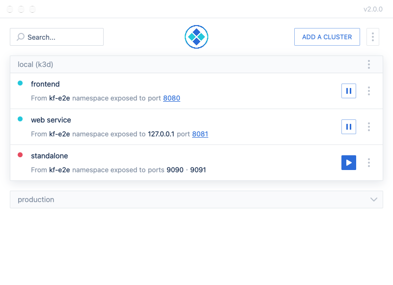

<h1 align="center">Kube Forwarder</h1>
<h3 align="center">Easy to use Kubernetes port forwarding manager</h3>
<h4 align="center">
  <a href="https://kube-forwarder.pixelpoint.io">Website</a> ·
  <a href="#build-from-source">Build from source</a> ·
  <a href="#install-with-homebrew">Install with Homebrew</a>
</h4>



Kube Forwarder 2 is a native rewrite of the application in Rust with
[GPUI](https://www.gpui.rs) (the UI framework of the Zed editor). It runs natively on Apple
Silicon: the 1.x releases were x86_64-only Electron builds that need Rosetta 2, which is
going away in upcoming macOS versions. The new application is a single ~25 MB binary that
doesn't need Node.js, Electron or `kubectl`.

## Features

**Auto-reconnect** — every local connection opens its own port-forward stream, a broken
connection never takes the forwarding down. When the pod behind a deployment or a service is
replaced (rollout, eviction, ...), the new pod is picked up automatically.

**Multiple clusters support** — bookmark and forward Kubernetes resources from multiple
clusters.

**Share bookmarks** — export a cluster with its resources to JSON (with or without the kube
config) and import it on another machine. Exports of Kube Forwarder 1.x can be imported.

**Zero native dependencies** — no `kubectl` needed. Credential plugins used by kube configs
(`aws`, `gcloud`/`gke-gcloud-auth-plugin`, `kubelogin`, ...) are found even when the app is
started from Finder: the environment of the login shell is imported at startup.

**Seamless upgrade** — on the first launch, clusters and resources of Kube Forwarder 1.x are
imported automatically.

## Optional dependencies

* [Google Cloud SDK](https://cloud.google.com/sdk/)
* [AWS CLI](https://docs.aws.amazon.com/cli/)

## Functionality walk-through

### Add a cluster(s)

Before you start forwarding internal resources to your local machine, you have to add a
cluster configuration. There are several options:

1. Auto-detection of the `~/.kube/config` file: every context of the file can be added as a
   cluster.
1. Opening kube config file(s): when a file contains multiple contexts, you choose the ones to
   add.
1. Pasting a kube config as text.
1. Restoring a JSON file exported by Kube Forwarder.

The cluster form has the following fields:

* Name - the name of the cluster within Kube Forwarder.
* Storing method:
    * `Set a path` - only the path to the config file is stored. The file is read every time
      a port is forwarded, so tools that update the file (for example when `azure-cli`
      refreshes an access token) keep working without changes in Kube Forwarder.
    * `Paste as a text` - the whole config is stored as text.
* Path (`Set a path`) - the path to a config file.
* Current context (`Set a path`) - the context of the file used to connect. It's stored
  separately so that `kubectl config use-context` doesn't change the cluster Kube Forwarder
  connects to.
* Content (`Paste as a text`) - the kube config as text.

### Add a resource

Kube Forwarder supports forwarding of Pods, Deployments and Services.

* **Cluster Name** - one of the added clusters.
* **Namespace** - the namespace of the resource (suggestions are loaded from the cluster).
* **Kind** - Pod, Deployment or Service.
* **Name** - the name of the Pod, Deployment or Service (suggestions are loaded from the
  cluster).
* **Alias** - an alternative name displayed in the list (optional).
* **Port Forwarding**
    * **Local port** - the port on your machine.
    * **Resource port** - the port of the resource. For services it's a service port, which is
      mapped to the target port of the pod (named target ports are supported).
* **Use Custom Local Address** - listen on another address than `localhost` (which listens on
  `127.0.0.1` and `::1`). Putting each resource on its own address avoids collisions of ports
  and cookies. On macOS only `127.0.0.1` is configured on the loopback interface, add other
  addresses first, e.g. `sudo ifconfig lo0 alias 127.0.0.2 up`.

Ports that answer HTTP requests are displayed as links.

### Import/Export

A cluster can be exported to JSON to share it with your team or to back it up. The export can
include the kube config or not. Configs referenced by path are embedded as text.

### Where is the data stored?

`~/Library/Application Support/com.pixelpoint.kube-forwarder/state.json` on macOS
(`$XDG_DATA_HOME/com.pixelpoint.kube-forwarder/state.json` on Linux). The file is only
readable by your user because kube configs pasted as text may contain credentials. Set
`KUBE_FORWARDER_STATE` to use another file.

### Install with Homebrew

```
brew install --cask kube-forwarder
```

## Build from source

Requirements:

* macOS 11 or newer (Apple Silicon or Intel)
* [Rust](https://rustup.rs) 1.95 or newer
* Xcode Command Line Tools (`xcode-select --install`). The full Xcode is not needed: the Metal
  shaders are compiled at runtime.

```sh
# Run the application
cargo run -p kube-forwarder

# Build "Kube Forwarder.app" and kube-forwarder.dmg into dist/
scripts/bundle-macos.sh
scripts/bundle-macos.sh --universal   # arm64 + x86_64
```

Set `MACOS_SIGNING_IDENTITY` to sign the bundle with a Developer ID certificate, otherwise it's
signed ad hoc. Distributed builds also have to be notarized
(`xcrun notarytool submit dist/kube-forwarder.dmg --wait`).

GPUI also supports Linux and Windows, but the application is only tested on macOS.

## Project structure

* `crates/kf-core` - everything that doesn't depend on the UI: the persisted model, migration
  of the 1.x data, import/export, kube config handling and the port forwarding engine
  ([kube-rs](https://kube.rs)).
* `crates/kube-forwarder` - the GPUI application. Widgets come from
  [gpui-component](https://github.com/longbridge/gpui-component).

## Running the tests

```sh
# Unit tests and UI tests (GPUI test platform, no window is opened)
cargo test --workspace

# End-to-end tests against a disposable k3d cluster (needs Docker, k3d and kubectl).
# Your ~/.kube/config is not modified.
scripts/e2e.sh
```

The end-to-end tests forward ports of pods, deployments and services (with named target
ports), follow pods that get replaced, check error reporting and start/stop forwarding from
the UI.

Debug builds accept two environment variables that help with screenshots:
`KUBE_FORWARDER_DEBUG_ROUTE` opens a page (`add`, `new`, `edit:<cluster id>`,
`resource-new:<cluster id>`, `resource-edit:<id>`, `resource-clone:<id>`) and
`KUBE_FORWARDER_DEBUG_START` starts resources (comma separated ids).
`KUBE_FORWARDER_LOG` sets the log filter (for example `debug`).

## Contributing

We encourage you to contribute to Kube Forwarder!

We expect contributors to abide by our underlying [code of conduct](./.github/CODE_OF_CONDUCT.md).
All conversations and discussions on GitHub (issues, pull requests) must be respectful and
harassment-free.

1. Fork the project & clone locally.
2. Create a branch, naming it either a feature or bug: `git checkout -b feature/that-new-feature` or `bug/fixing-that-bug`
3. Code and commit your changes. Bonus points if you write a [good commit message](https://chris.beams.io/posts/git-commit/).
4. Push to the branch: `git push origin feature/that-new-feature`
5. Create a pull request for your branch 🎉

## License

This project is licensed under the MIT License - see the LICENSE.md file for details
